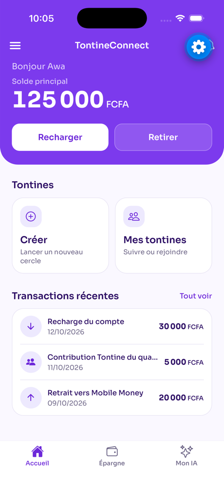
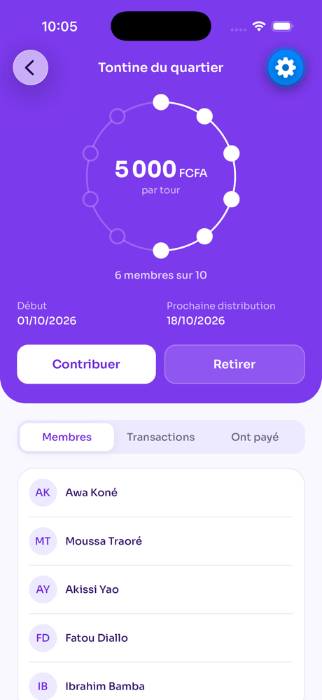
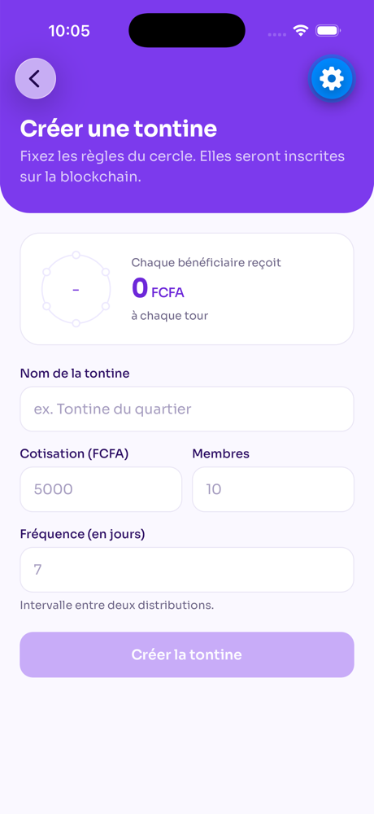

# TontineConnect

Application de tontine et d'épargne sur blockchain (Ethereum / Ganache).

| Dossier | Contenu |
|---|---|
| [`mobile/`](mobile) | App Expo SDK 57 (React Native, TypeScript, NativeWind, expo-router) |
| [`backend/`](backend) | API FastAPI (PostgreSQL, JWT, web3.py, Gemini) |
| [`docs/screenshots/`](docs/screenshots) | Captures d'écran de l'application |

## Captures

| Connexion | Accueil | Épargne |
|---|---|---|
|  |  |  |

| Tontines | Détail d'une tontine | Créer une tontine |
|---|---|---|
|  |  |  |

| Cours | Assistant IA | Inscription |
|---|---|---|
|  |  |  |

## Backend

```bash
cd backend
python3 -m venv .venv && source .venv/bin/activate
pip install -r requirements-dev.txt
cp .env.example .env   # puis adapter les valeurs

uvicorn main:app --reload      # http://127.0.0.1:8000/docs
```

Variables d'environnement : `DATABASE_URL`, `SECRET_KEY`, `GEMINI_API_KEY`, `GANACHE_URL`.

### Tester le backend

```bash
cd backend && pytest
```

Les tests utilisent SQLite (aucun PostgreSQL requis) et mockent la blockchain (aucun Ganache requis).
Pour tester à la main : lancer `uvicorn`, ouvrir <http://127.0.0.1:8000/docs> (Swagger), créer un
utilisateur via `POST /user/createUser`, puis cliquer sur **Authorize** pour obtenir un token.

## Mobile

```bash
cd mobile
npm install --legacy-peer-deps
npx expo start --go        # puis « i » pour le simulateur iOS
```

L'IP du backend vaut `192.168.1.12` par défaut (`mobile/constants/server_ip.ts`) et se surcharge sans toucher au code :

```bash
EXPO_PUBLIC_SERVER_IP=192.168.1.54 npx expo start --go
```

### Mettre à jour les captures

Avec l'app ouverte dans le simulateur iOS :

```bash
xcrun simctl io booted screenshot docs/screenshots/<nom>.png
```
